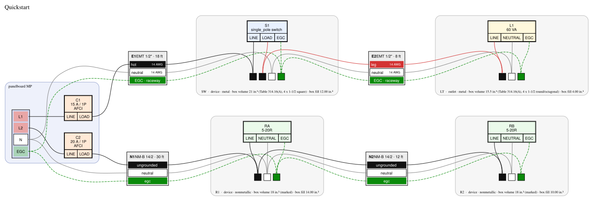

# pigtail

**House wiring as code.** Describe a home's electrical system in YAML — the panel and its
breakers, the cables and conduit, every box, splice, and device — and pigtail draws it
wire by wire, traces which circuit every conductor is on, and checks it against the
National Electrical Code (NEC 2023): conductor sizing, box fill, conduit fill and derating,
shared neutrals, continuous loads, voltage drop, and more.

Named after the *pigtail*: the short wire from a splice to a device terminal, found in
almost every box it draws.

## Install

```bash
pip install pigtail
```

Python 3.13 or later. Drawings need [Graphviz](https://graphviz.org/download/)
(`brew install graphviz`, `apt install graphviz`).

## Quickstart

Describe the wiring: what connects to what.

```yaml
# Two branch circuits from one panel:
#   C1  15 A lighting: EMT to a switch box, a switch loop on to a ceiling light
#   C2  20 A receptacles: NM-B cable daisy-chained through two receptacle boxes
# C2 is wired in 14 AWG cable, which the check flags: 14 AWG is limited to 15 A.

meta:
  project: Quickstart
  code_edition: NEC-2023

boxes:                            # volume from Table 314.16(A), or as marked
  - {id: SW, type: device, material: metal, shape: square, trade_size: "4 x 1-1/2"}
  - {id: LT, type: outlet, material: metal, shape: round/octagonal, trade_size: "4 x 1-1/2"}
  - {id: R1, type: device, material: nonmetallic, volume_cu_in: 18.0}
  - {id: R2, type: device, material: nonmetallic, volume_cu_in: 18.0}

panelboards:
  - id: MP
    main_breaker: {ampere_rating: 100}
    branch_circuits:              # the breakers
      - id: C1
        circuit_breaker: {line: L1, ampere_rating: 15, afci: true}
      - id: C2
        circuit_breaker: {line: L2, ampere_rating: 20, afci: true}

    splices:                      # the landings: each wire on a breaker or a busbar
      - join: [E1.hot, C1.LOAD]
      - join: [E1.neutral, MP.NEUTRAL]
      - join: [E1.egc, MP.EGC]    # EMT: the tubing is the ground
      - join: [N1.ungrounded, C2.LOAD]
      - join: [N1.neutral, MP.NEUTRAL]
      - join: [N1.egc, MP.EGC]

    cables:                       # the runs leaving the panel, as a tree
      - id: E1
        type: EMT
        trade_size: "1/2"
        size_awg: 14
        length_ft: 18
        to: SW
        pulled:                   # EMT: each wire, by colour
          - {name: hot, role: ungrounded, color: black}
          - {name: neutral, role: neutral, color: white}
        devices:
          - {id: S1, type: snap_switch}
        splices:                  # in box SW
          - join: [E1.hot, S1.LINE]
          - join: [S1.LOAD, E2.leg]
          - join: [E1.neutral, E2.neutral]
          - join: [E1.egc, E2.egc, S1.EGC]
        cables:
          - id: E2
            type: EMT
            trade_size: "1/2"
            size_awg: 14
            length_ft: 8
            to: LT
            pulled:
              - {name: leg, role: ungrounded, color: red}      # the switched hot
              - {name: neutral, role: neutral, color: white}
            devices:
              - {id: L1, type: luminaire, load_va: 60}
            splices:              # in box LT
              - join: [E2.leg, L1.LINE]
              - join: [E2.neutral, L1.NEUTRAL]
              - join: [E2.egc, L1.EGC]

      - id: N1
        type: NM-B
        size_awg: 14              # on a 20 A breaker: flagged
        conductors: 2
        length_ft: 30
        to: R1
        devices:
          - {id: RA, type: receptacle, nema: 5-20R}
        splices:                  # in box R1
          - join: [N1.ungrounded, RA.LINE, N2.ungrounded]
          - join: [N1.neutral, RA.NEUTRAL, N2.neutral]
          - join: [N1.egc, RA.EGC, N2.egc]
        cables:
          - id: N2
            type: NM-B
            size_awg: 14
            conductors: 2
            length_ft: 12
            to: R2
            devices:
              - {id: RB, type: receptacle, nema: 5-20R}
            splices:              # in box R2
              - join: [N2.ungrounded, RB.LINE]
              - join: [N2.neutral, RB.NEUTRAL]
              - join: [N2.egc, RB.EGC]
```

Draw it:

```bash
pigtail draw examples/quickstart.yaml -o quickstart.svg
```



Check it:

```console
$ pigtail check examples/quickstart.yaml
240.4(D): cable N1 -- N1.ungrounded (14 AWG NM-B 14/2) carries 15 A, under circuit C2's 20 A breaker
240.4(D): cable N2 -- N2.ungrounded (14 AWG NM-B 14/2) carries 15 A, under circuit C2's 20 A breaker
Table 250.122: cable N1 -- EGC N1.egc is 14 AWG; a 20 A circuit needs 12 AWG
Table 250.122: cable N2 -- EGC N2.egc is 14 AWG; a 20 A circuit needs 12 AWG

4 violation(s)
```

## Features

- **Topology in, circuits out.** The YAML says only what connects to what. pigtail traces
  each hot back to its breaker (through splices and switches) and each neutral out to the
  loads it returns — so shared neutrals (multiwire branch circuits) are found, not declared.
- **Real wiring methods.** NM-B cable; EMT conduit with each wire pulled in by colour and
  tape, the tubing as the equipment ground; knob-and-tube, as found in older houses.
- **A conductor-level drawing.** Every wire in its own colour, every box with its wire nuts,
  box volume and box fill on each box; SVG, PNG, or PDF. Every element carries a
  `circuit-<id>` SVG class, so a viewer can hide or show circuits.
- **NEC checks, warn-only.** An as-built house can hold violations; pigtail reports them
  instead of refusing the model. Each finding cites its NEC section.
- **Honest about missing data.** A rule that needs a value you haven't recorded (a box
  volume, a run length, a load) is reported as *not checked*, never guessed.
- **Box fill** (314.16) from a box's Table 314.16(A) trade size or its marked volume, plus
  extension rings, plaster rings, and covers.
- **Conduit fill and ampacity** (Chapter 9, 310.15, 110.14(C)): fill against Table 1,
  current-carrying conductors and their adjustment, ambient correction, terminal
  temperature limits, 240.4(B) and 240.4(D).
- **Loads**: continuous loads and EV charging at 125 % (210.19, 210.20, 625.41), receptacle
  ratings (210.21(B)), voltage drop (210.19(A) Informational Note No. 4).
- **Bill of materials**: cable and conduit footage, THHN per gauge, boxes (with the ones too
  small and a standard size that fits), devices, breakers, connectors.
- **Every NEC number in one table module** (`pigtail.nec_tables`), named after its table:
  `TABLE_310_16`, `TABLE_314_16_A`, `CHAPTER_9_TABLE_5`, ...
- **KiCad netlist and schedules**: panel, conductor, raceway, and net schedules; the
  circuit is a [SKiDL](https://github.com/devbisme/skidl) netlist underneath.

## Command line

```bash
pigtail check house.yaml                  # NEC findings, then the rules not checked
pigtail draw  house.yaml -o house.svg     # the drawing (.svg, .png, .pdf); --circuit C1 for one
pigtail bom   house.yaml                  # bill of materials
pigtail build house.yaml --out ./out      # netlist, DOT, panel / conductor / raceway schedules
```

## Python

```python
import warnings
from pathlib import Path

from pigtail.models.house import House
from pigtail.nec import NECViolation
from pigtail.outputs.diagram import circuit_diagram

house = House.from_yaml(Path("house.yaml"))  # House.from_dict(...) also works
dot = circuit_diagram(house, only="C1")  # Graphviz DOT source

with warnings.catch_warnings(record=True) as found:
    warnings.simplefilter("always")
    house.check()  # one NECViolation / NECUnchecked warning per finding
for w in found:
    kind = "violation" if issubclass(w.category, NECViolation) else "not checked"
    print(kind, w.message)

bc = house.branch_circuit("C2")
print([c.id for c in bc.all_cables()], [d.id for d in bc.devices()])  # traced
print(house.raceway_schedule())
print(house.bom())
```

## The YAML

- **`boxes`** — every box, top-level (one box can hold several circuits): `id`, `type`
  (`device`, `outlet`, `junction`, `pull`), `material` (`metal`, `nonmetallic`), and its
  volume one way: `shape` + `trade_size` from Table 314.16(A) (`square` / `"4 x 2-1/8"`,
  `round/octagonal`, `device`, ...), or `volume_cu_in` as marked. `additions`: extension
  rings, plaster rings, domed or raised covers, each by trade size or marked volume.
- **`panelboards`** — `id`, `main_breaker`, `service`; `branch_circuits` (the breakers:
  `ampere_rating`, `poles`, `line` L1/L2 for 1-pole, `afci`, `gfci`, `terminal_c`);
  `splices`, the landings: each wire on `<circuit>.LOAD` (2-pole: `LOAD1` / `LOAD2`),
  `<panel>.NEUTRAL`, or `<panel>.EGC`; `cables`, the runs leaving the panel.
- **`cables`** — one run each, as a tree: the box it lands in (`to`; left out when its far
  end isn't traced yet), then that box's `devices`, `splices`, and onward `cables`.
  - `type: NM-B | EMT | knob_and_tube`, `size_awg`, `length_ft`, EMT `trade_size`,
    `ambient_c`, `bends_deg`.
  - Cable assemblies give `conductors: 2 | 3` (the "/2", "/3"; the ground wire is added);
    `reidentify` marks a re-taped white (200.7(C)(1)).
  - EMT runs list every wire `pulled`: `name`, `role` (`ungrounded`, `neutral`, `traveler`,
    `egc`), `color`, `tape`, and optionally `size_awg`, `insulation`, `stranding`. The tubing
    is the run's ground, `<run>.egc`.
- **`devices`** — `snap_switch` (`LINE`, `LOAD`, `EGC`); `luminaire` (`load_va`);
  `receptacle` (`nema`, `poles`, `gfci`, `terminal_c`, `load_va`, `continuous`);
  `appliance`, hardwired (`load_va`, `poles`). Terminals: `LINE`, `NEUTRAL`, `EGC`, or
  `LINE1` / `LINE2` at 240 V.
- **`splices`** — wire nuts: `join: [<run>.<wire>, <device>.<TERMINAL>, ...]`. One member is
  a wire capped alone; `through: true` is one wire passing through a box unspliced.

Leave a value out rather than guess it: pigtail reports what it then can't check.

## NEC checks

| Section | Check |
|---|---|
| 110.7, 200.11 | the wiring agrees with each conductor's declared role |
| 110.14(C), 310.15, 240.4 | ampacity in conduit: insulation, adjustment, ambient, terminals |
| 200.4(A), 210.4(B) | shared neutrals: opposite legs, simultaneous disconnect, sizing |
| 200.6(A), 200.7(C)(1) | neutral colour; re-identified whites |
| 210.12(A) | AFCI on 120 V 15/20 A circuits |
| 210.19(A), 210.20(A), 625.41 | continuous loads at 125 % |
| 210.19(A) IN No. 4 | voltage drop over 3 % |
| 210.21(B) | receptacle rating against its circuit |
| 240.4(D), 334.80 | small conductors and NM cable |
| Table 250.122 | equipment grounding conductor size |
| 310.3(C) | 8 AWG and larger stranded in conduit |
| 314.16 | box volume against box fill |
| 358.22, Chapter 9 | conduit fill |
| 358.26 | bends between pull points |
| 394.12 | knob-and-tube |
| 406.4(D)(2), 406.12 | ungrounded and tamper-resistant receptacles |

Rules that depend on data the model doesn't carry — a room's use (e.g. where GFCI is
required), mounting heights, geometry — are left out rather than guessed.

## Limits

pigtail is a modelling and checking aid. It is not a substitute for the Code itself, for
your authority having jurisdiction (which may amend the NEC), or for a licensed electrician.
Findings cover only what the model records.

NEC values are transcribed from NFPA 70, *National Electrical Code*, 2023 edition.
pigtail is not affiliated with or endorsed by the NFPA. NEC® and National Electrical Code®
are registered trademarks of the National Fire Protection Association.

## Development

```bash
uv sync
uv run ruff check && uv run ruff format --check && uv run mypy && uv run pytest
```

See [AGENTS.md](AGENTS.md) for the layout and design rules.

## License

[MIT](LICENSE)
